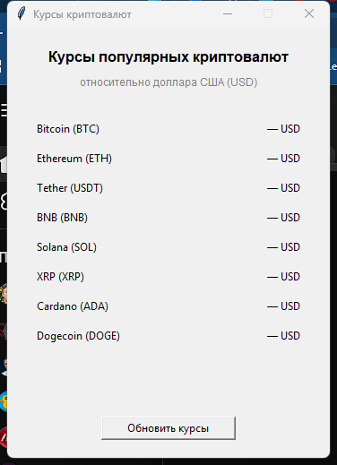

# ИТОГОВАЯ РАБОТА

## Приложение "Курсы криптовалют"

---

# 1. Титульный лист

---

**Министерство труда и социальной защиты**  
**Центр занятости населения**  
**Курсы по направлению "Программирование на языке Python"**

<br/><br/>

### ИТОГОВАЯ РАБОТА

**Тема:** Разработка desktop-приложения для отображения курсов криптовалют с использованием открытого API

<br/><br/>

**Выполнил(а):** Обухов Александр  

**Группа:** ППБУ-1.3

**Преподаватель:** Голиков Д.В. 

<br/><br/><br/>

**год** 2026

---

# 2. Содержание

1. [Титульный лист](#1-титульный-лист)
2. [Содержание](#2-содержание)
3. [Введение](#3-введение)
4. [Техническое задание на разработку проекта](#4-техническое-задание-на-разработку-проекта)
5. [Результаты исследования открытых API, предоставляющих курсы криптовалют](#5-результаты-исследования-открытых-api-предоставляющих-курсы-криптовалют)
6. [Требования к графическому интерфейсу пользователя](#6-требования-к-графическому-интерфейсу-пользователя)
7. [Требования к тестированию](#7-требования-к-тестированию)
8. [Листинг программы](#8-листинг-программы)
9. [Заключение](#9-заключение)

---

# 3. Введение

Криптовалютный рынок характеризуется высокой волатильностью: котировки меняются в течение дня, поэтому пользователям нужны инструменты для быстрого просмотра актуальных курсов. Многие сервисы предоставляют такие данные через открытые HTTP API в формате JSON, что позволяет создать собственное клиентское приложение без разработки серверной части.

**Цель работы** - разработать desktop-приложение на языке Python с графическим интерфейсом, которое отображает курсы популярных криптовалют относительно доллара США (USD) по данным открытого API.

**Задачи работы:**
1. Изучить открытые API, предоставляющие курсы криптовалют, и выбрать подходящий источник данных.
2. Сформулировать техническое задание на разработку приложения.
3. Спроектировать удобный графический интерфейс на библиотеке tkinter.
4. Реализовать загрузку и разбор JSON-ответа, а также обработку сетевых ошибок.
5. Обеспечить чистую структуру кода (модули, классы, функции, комментарии).
6. Провести тестирование работоспособности приложения.

**Объект разработки** - desktop-приложение "Курсы криптовалют".

**Предмет разработки** - получение, обработка и визуализация данных о курсах криптовалют через открытое API.

**Практическая значимость** - приложение может использоваться как учебный пример работы с HTTP-запросами, JSON и GUI в Python, а также как простой инструмент для просмотра актуальных курсов без открытия браузера.

---

# 4. Техническое задание на разработку проекта

## 4.1. Назначение системы

Приложение предназначено для просмотра текущих курсов популярных криптовалют к доллару США. Данные загружаются из сети Интернет по запросу пользователя.

## 4.2. Функциональные требования

| № | Требование | Описание |
|---|------------|----------|
| 1 | Отображение списка криптовалют | Bitcoin, Ethereum, Tether, BNB, Solana, XRP, Cardano, Dogecoin |
| 2 | Загрузка курсов | Получение цен в USD через HTTP API |
| 3 | Формат данных | Ответ API в формате JSON |
| 4 | Обновление | Кнопка "Обновить курсы" для повторного запроса |
| 5 | Обработка ошибок | Сообщения при сбое сети, таймауте или некорректном JSON |
| 6 | Статус | Индикация загрузки и времени последнего успешного обновления |

## 4.3. Нефункциональные требования

- Язык реализации: **Python 3**.
- GUI: стандартная библиотека **tkinter / ttk** (без сторонних GUI-фреймворков).
- HTTP-клиент: **urllib.request** (стандартная библиотека).
- Внешние зависимости не требуются.
- Код должен быть структурирован: разделение на модули, использование классов и функций, наличие комментариев, отсутствие дублирования.

## 4.4. Стек технологий

| Компонент | Решение |
|-----------|---------|
| Язык | Python 3 |
| GUI | tkinter / ttk |
| HTTP | urllib.request |
| Формат данных | JSON |
| API | CoinGecko Simple Price |
| ОС | Windows / кроссплатформенно |

## 4.5. Структура проекта

```
итоговая/
├── main.py         # точка входа
├── config.py       # константы: список монет, URL API, таймаут
├── utils.py        # форматирование цены
├── client.py       # CryptoRatesClient - запрос и разбор JSON
├── app.py          # CryptoRatesApp - интерфейс tkinter
├── interface.png   # скриншот интерфейса
├── ТЗ.md           # пояснительная записка / ТЗ
└── .gitignore
```

## 4.6. Модель данных и API-запрос

Базовый URL:

```
https://api.coingecko.com/api/v3/simple/price
```

Параметры запроса:

| Параметр | Значение |
|----------|----------|
| `ids` | `bitcoin,ethereum,tether,binancecoin,solana,ripple,cardano,dogecoin` |
| `vs_currencies` | `usd` |

Пример успешного JSON-ответа:

```json
{
  "bitcoin": { "usd": 75854.00 },
  "ethereum": { "usd": 2237.39 },
  "tether": { "usd": 0.999017 },
  "binancecoin": { "usd": 695.96 },
  "solana": { "usd": 90.24 },
  "ripple": { "usd": 1.19 },
  "cardano": { "usd": 0.186387 },
  "dogecoin": { "usd": 0.072381 }
}
```

## 4.7. Запуск

```bash
python main.py
```

## 4.8. Критерии приёмки (итоговая аттестация)

| Критерий | Макс. балл |
|----------|------------|
| Работоспособность приложения | 2 |
| Корректность работы с API и JSON | 2 |
| Качество графического интерфейса (tkinter) | 2 |
| Чистота и структура кода | 2 |

**Оценка "отлично":** 7–8 баллов.

---

# 5. Результаты исследования открытых API, предоставляющих курсы криптовалют

Для выбора источника данных были рассмотрены несколько популярных открытых API.

## 5.1. Сравнительная таблица

| API | Бесплатный доступ | Ключ API | Формат | Простота запроса курса | Ограничения |
|-----|-------------------|----------|--------|------------------------|-------------|
| **CoinGecko** | Да | Не обязателен для базовых запросов | JSON | Высокая (`/simple/price`) | Лимит запросов без ключа |
| CoinCap | Да | Не обязателен | JSON | Высокая | Изменения API / лимиты |
| Binance Public API | Да | Не обязателен для публичных котировок | JSON | Средняя (торговые пары) | Ориентация на биржевые символы |
| CryptoCompare | Да (ограниченно) | Обычно требуется | JSON | Средняя | Лимиты бесплатного тарифа |
| CoinMarketCap | Ограниченно | Обязателен | JSON | Средняя | Строгие лимиты free-плана |

## 5.2. Обоснование выбора CoinGecko

Выбран **CoinGecko Simple Price API** по следующим причинам:

1. **Не нужен API-ключ** для базового запроса курсов - удобно для учебной работы.
2. **Простой endpoint** `/api/v3/simple/price` сразу возвращает цены по списку идентификаторов.
3. **Ответ в JSON** легко разбирается средствами стандартной библиотеки `json`.
4. **Документация** публична и понятна: https://www.coingecko.com/en/api
5. **Достаточный набор** популярных криптовалют доступен по стабильным `id` (`bitcoin`, `ethereum` и т.д.).

## 5.3. Альтернативы и почему они не выбраны

- **Binance** ориентирован на торговые пары (`BTCUSDT`), а не на "человекочитаемые" идентификаторы монет; для учебного GUI менее нагляден.
- **CoinMarketCap** требует регистрации и ключа уже на старте.
- **CryptoCompare** для стабильной работы обычно также предполагает ключ и учёт квот.

**Вывод исследования:** для проекта оптимален CoinGecko - бесплатный базовый доступ, JSON, минимальная сложность интеграции.

---

# 6. Требования к графическому интерфейсу пользователя

## 6.1. Общие требования

- Интерфейс реализуется на **tkinter**.
- Окно должно быть понятным пользователю без инструкции.
- Элементы располагаются логично: заголовок → список курсов → статус → кнопка обновления.
- Размер окна фиксированный, достаточный для отображения всего списка без прокрутки.

## 6.2. Элементы интерфейса

| Элемент | Назначение |
|---------|------------|
| Заголовок | "Курсы популярных криптовалют" |
| Подзаголовок | Уточнение: относительно USD |
| Список из 8 строк | Название монеты слева, цена справа |
| Строка статуса | Подсказка / "Загрузка…" / время обновления / текст ошибки |
| Кнопка "Обновить курсы" | Запуск запроса к API |

## 6.3. Поведение интерфейса

1. При старте цены отображаются как "- USD".
2. По нажатию кнопки выполняется запрос; кнопка временно блокируется.
3. При успехе цены обновляются, в статусе показывается время.
4. При ошибке открывается `messagebox` с понятным текстом, статус отражает тип сбоя.

## 6.4. Эскиз интерфейса

Скриншот главного окна:



Схематичный макет:

```
┌──────────────────────────────────────┐
│  Курсы криптовалют              _ □ ×│
├──────────────────────────────────────┤
│                                      │
│   Курсы популярных криптовалют       │
│   относительно доллара США (USD)     │
│                                      │
│   Bitcoin (BTC)          - USD       │
│   Ethereum (ETH)         - USD       │
│   Tether (USDT)          - USD       │
│   BNB (BNB)              - USD       │
│   Solana (SOL)           - USD       │
│   XRP (XRP)              - USD       │
│   Cardano (ADA)          - USD       │
│   Dogecoin (DOGE)        - USD       │
│                                      │
│   Нажмите "Обновить курсы"…          │
│                                      │
│        [ Обновить курсы ]            │
│                                      │
└──────────────────────────────────────┘
```

После успешного обновления (пример):

```
│   Bitcoin (BTC)       75,854.00 USD  │
│   Ethereum (ETH)       2,237.39 USD  │
│   ...                                │
│   Обновлено: 16:45:12                │
```

---

# 7. Требования к тестированию

## 7.1. Цели тестирования

Проверить, что приложение:
- запускается без ошибок;
- корректно загружает и отображает курсы;
- правильно обрабатывает сетевые и логические сбои;
- сохраняет удобство интерфейса при повторных обновлениях.

## 7.2. Тест-кейсы

| № | Сценарий | Шаги | Ожидаемый результат |
|---|----------|------|---------------------|
| Т1 | Успешный запуск | Выполнить `python main.py` | Окно открывается, список из 8 монет виден |
| Т2 | Успешное обновление | При наличии интернета нажать "Обновить курсы" | Цены заменены числовыми значениями, статус "Обновлено: ЧЧ:ММ:СС" |
| Т3 | Повторное обновление | Нажать кнопку ещё раз | Курсы обновляются повторно без падения приложения |
| Т4 | Ошибка сети | Отключить интернет / заблокировать доступ и нажать обновление | Диалог "Ошибка сети", статус с текстом об ошибке, приложение не закрывается |
| Т5 | Форматирование цен | Сравнить крупные (BTC) и мелкие (DOGE) значения | Крупные - с разделителями тысяч и 2 знаками; мелкие - с большей точностью |
| Т6 | Блокировка кнопки | Нажать "Обновить курсы" во время загрузки | Кнопка недоступна на время запроса, затем снова активна |
| Т7 | Структура кода | Просмотреть модули проекта | Логика разделена: `config`, `client`, `app`, `utils`, `main` |

## 7.3. Критерии успешности тестирования

Тестирование считается пройденным, если выполнены Т1–Т3 и Т5–Т7, а Т4 подтверждает корректную обработку ошибок без аварийного завершения.

---

# 8. Листинг программы

Ниже приведён исходный код модулей приложения.

## 8.1. `main.py` - точка входа

```python
# Итоговая работа: приложение "Курсы криптовалют".
from app import CryptoRatesApp

def main() -> None:
    app = CryptoRatesApp()
    app.run()

if __name__ == "__main__":
    main()
```

## 8.2. `config.py` - константы

```python
#Константы приложения: список монет и параметры API.
CRYPTOS: dict[str, str] = {
    "bitcoin": "Bitcoin (BTC)",
    "ethereum": "Ethereum (ETH)",
    "tether": "Tether (USDT)",
    "binancecoin": "BNB (BNB)",
    "solana": "Solana (SOL)",
    "ripple": "XRP (XRP)",
    "cardano": "Cardano (ADA)",
    "dogecoin": "Dogecoin (DOGE)",
}

API_URL = "https://api.coingecko.com/api/v3/simple/price"
REQUEST_TIMEOUT_SEC = 10
```

## 8.3. `utils.py` - форматирование

```python
# Вспомогательные функции форматирования.

def format_price(value: float) -> str:
    if value >= 1000:
        return f"{value:,.2f} USD"
    if value >= 1:
        return f"{value:.2f} USD"

    return f"{value:.6f} USD"
```

## 8.4. `client.py` - клиент API

```python
# Клиент API CoinGecko: загрузка и разбор JSON с курсами.
from __future__ import annotations
import json
import urllib.parse
import urllib.request
from config import API_URL, CRYPTOS, REQUEST_TIMEOUT_SEC

class CryptoRatesClient:
    # Клиент API: загрузка и разбор JSON с курсами.
    def __init__(
        self,
        crypto_ids: dict[str, str] | None = None,
        api_url: str = API_URL,
        timeout: int = REQUEST_TIMEOUT_SEC,
    ) -> None:
        self.crypto_ids = crypto_ids or CRYPTOS
        self.api_url = api_url
        self.timeout = timeout

    def _build_url(self) -> str:
        # Собирает URL запроса с нужными параметрами.
        params = urllib.parse.urlencode(
            {
                "ids": ",".join(self.crypto_ids.keys()),
                "vs_currencies": "usd",
            }
        )

        return f"{self.api_url}?{params}"

    def fetch_rates(self) -> dict[str, float]:
        # Запрашивает курсы у CoinGecko и возвращает словарь id → цена USD.
        request = urllib.request.Request(
            self._build_url(),
            headers={"Accept": "application/json"},
        )

        with urllib.request.urlopen(request, timeout=self.timeout) as response:
            raw = response.read().decode("utf-8")
            data = json.loads(raw)

        rates: dict[str, float] = {}

        for crypto_id, title in self.crypto_ids.items():
            if crypto_id not in data or "usd" not in data[crypto_id]:
                raise KeyError(f"курс для {title} не найден")
            rates[crypto_id] = float(data[crypto_id]["usd"])

        return rates
```

## 8.5. `app.py` - графический интерфейс

```python
# Графический интерфейс приложения на tkinter.
from __future__ import annotations
import json
import tkinter as tk
import urllib.error
from datetime import datetime
from tkinter import messagebox, ttk
from client import CryptoRatesClient
from utils import format_price


class CryptoRatesApp:
    # Графическое приложение на tkinter для отображения курсов.
    def __init__(self, client: CryptoRatesClient | None = None) -> None:
        self.client = client or CryptoRatesClient()
        self.price_labels: dict[str, tk.Label] = {}

        self.window = tk.Tk()
        self.window.title("Курсы криптовалют")
        self.window.geometry("380x520")
        self.window.resizable(False, False)

        self._build_ui()

    def _build_ui(self) -> None:
        # Создаёт элементы интерфейса и раскладывает их по окну.
        tk.Label(
            self.window,
            text="Курсы популярных криптовалют",
            font=("", 12, "bold"),
        ).pack(pady=(20, 5))

        tk.Label(
            self.window,
            text="относительно доллара США (USD)",
            font=("", 9),
            fg="gray",
        ).pack(pady=(0, 10))

        frame = ttk.Frame(self.window, padding=10)
        frame.pack(fill="both", expand=True, padx=20)
        frame.columnconfigure(0, weight=1)
        frame.columnconfigure(1, weight=0)

        for row, (crypto_id, title) in enumerate(self.client.crypto_ids.items()):
            tk.Label(frame, text=title, anchor="w").grid(
                row=row, column=0, sticky="w", pady=6
            )
            price = tk.Label(frame, text="- USD", anchor="e", width=14)
            price.grid(row=row, column=1, sticky="e", pady=6, padx=(10, 0))
            self.price_labels[crypto_id] = price

        self.status_label = tk.Label(
            self.window,
            text="Нажмите "Обновить курсы", чтобы загрузить данные",
            font=("", 8),
            fg="gray",
            wraplength=340,
        )
        self.status_label.pack(pady=(5, 0))

        self.refresh_button = tk.Button(
            self.window,
            text="Обновить курсы",
            command=self.update_rates,
            width=20,
        )
        self.refresh_button.pack(pady=18)

    def _set_status(self, text: str) -> None:
        # Обновляет строку статуса под списком курсов.
        self.status_label.config(text=text)

    def _show_prices(self, rates: dict[str, float]) -> None:
        # Подставляет загруженные цены в метки интерфейса.
        for crypto_id, price in rates.items():
            self.price_labels[crypto_id].config(text=format_price(price))

        now = datetime.now().strftime("%H:%M:%S")
        self._set_status(f"Обновлено: {now}")

    def update_rates(self) -> None:
        # Загружает курсы и обновляет интерфейс; показывает ошибки пользователю.
        self.refresh_button.config(state="disabled")
        self._set_status("Загрузка данных…")
        self.window.update_idletasks()

        try:
            rates = self.client.fetch_rates()
        except urllib.error.URLError:
            messagebox.showerror(
                "Ошибка сети",
                "Не удалось подключиться к CoinGecko.\n"
                "Проверьте интернет-соединение и попробуйте снова.",
            )
            self._set_status("Ошибка сети. Повторите попытку.")
        except TimeoutError:
            messagebox.showerror(
                "Ошибка сети",
                "Превышено время ожидания ответа от сервера.",
            )
            self._set_status("Таймаут запроса. Повторите попытку.")
        except (KeyError, ValueError, TypeError, json.JSONDecodeError) as error:
            messagebox.showerror(
                "Ошибка данных",
                f"Не удалось разобрать ответ API:\n{error}",
            )
            self._set_status("Ошибка разбора JSON. Повторите попытку.")
        else:
            self._show_prices(rates)
        finally:
            self.refresh_button.config(state="normal")

    def run(self) -> None:
        self.window.mainloop()
```

---

# 9. Заключение

В ходе итоговой работы разработано desktop-приложение "Курсы криптовалют" на языке Python.

**Достигнутые результаты:**
1. Проведено сравнение открытых API; в качестве источника данных выбран CoinGecko Simple Price.
2. Составлено техническое задание и определены функциональные и нефункциональные требования.
3. Реализован графический интерфейс на tkinter с кнопкой обновления и строкой статуса.
4. Обеспечена корректная работа с HTTP и JSON, включая обработку ошибок сети и разбора данных.
5. Код организован по модулям и классам (`config`, `client`, `app`, `utils`, `main`), что повышает читаемость и соответствует критерию чистоты структуры.

Приложение запускается командой `python main.py`, не требует установки сторонних библиотек и может быть использовано для демонстрации навыков работы с API, JSON и GUI в рамках курса Python.

**Возможные направления развития:** автообновление курсов по таймеру, выбор валюты котировки (EUR, RUB), сохранение истории обновлений, тёмная тема интерфейса.
